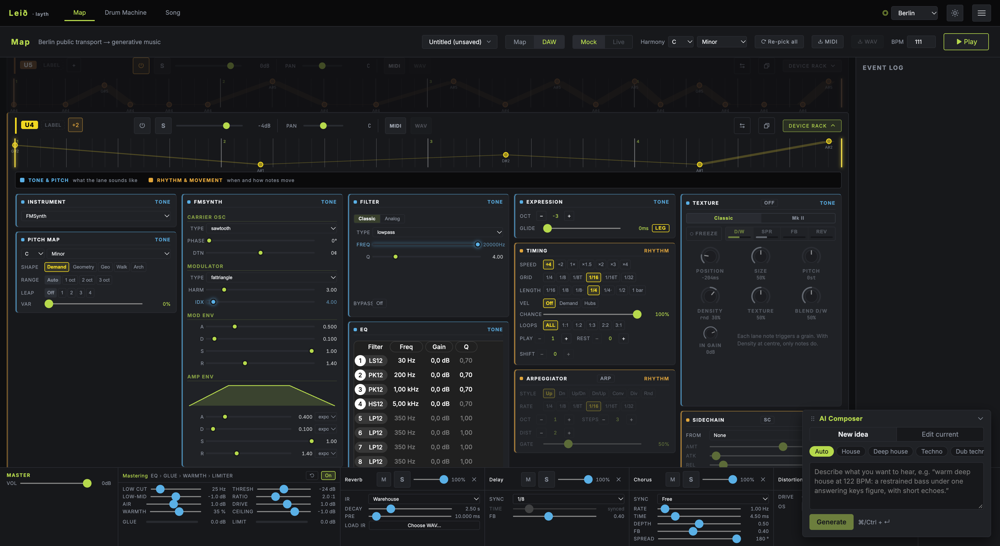
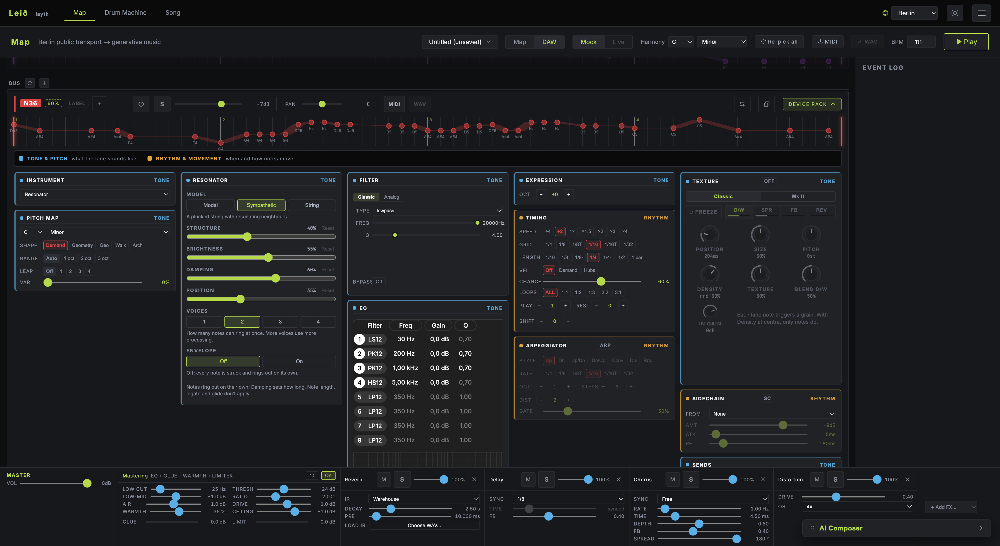

# How I Made a Track from Berlin's Transport Map

Berlin's U4 route plays the bass in this arrangement. Bus N36 adds plucked strings. Both parts start with transport data, and I choose the instruments that turn their patterns into sound.

I made the track in **Leið**, pronounced “layth”, the browser instrument I'm building at DeettaLabs. The arrangement runs at **111 BPM**, with **C minor** selected in the harmony controls. Other routes and drums complete the mix.

[Watch the 26-second Berlin breakdown](https://www.youtube.com/shorts/aEv8wIURHRg), then [open the Berlin arrangement](https://www.layth.space/?shared=shr_8750587429f441ba) to explore the patch while reading.

## The route gives me a pattern to work with

In Leið, a transport route becomes a musical lane. Its stops supply a sequence of note events, while the pitch mapping and harmony settings help determine the notes they play. The instrument on that lane gives those events their sound.

That leaves plenty of decisions to make. A pattern can sit low in the arrangement as a bass part, or move into a higher register with a different instrument. Playback speed and note length affect how it fits around the other voices.

This session uses **Mock mode**, with simulated playback over Berlin/VBB route data. The sounds come from Leið's instruments; the patterns come from the transport-data mapping. The recording does not follow live vehicle arrivals.

## U4 takes the bass part

For U4, I used **FMSynth** and set its register **three octaves down**. The visible note pattern reaches into the first and second octaves. That puts it below the upper voices and gives it a clear place in the arrangement.

FM synthesis changes an oscillator's sound using another oscillator. It offers a way to alter the character of this bass while keeping the same sequence of notes.

The lane runs at **quarter speed**, giving its phrase a slower pace. Its level is **−4 dB**. Those settings give U4 a slower, lower part beneath N36's plucked voice.

*U4's register, instrument and playback speed establish its bass role.*

## N36 adds plucked strings

N36 uses the **Resonator** instrument in **Sympathetic** mode. The instrument describes this as a plucked string with resonating neighbours. It gives the route a different articulation from the FM bass.

Here, the resonator has **two voices**, allowing two notes to ring at once. The lane runs at **half speed**, with **note chance at 60%**. Some note events can therefore be skipped as the pattern plays. Its level is **−7 dB**.

The distinction between these two lanes comes from several choices together: their patterns, register, instruments and timing. U4 supplies a low part; N36 supplies the plucked-string voice above it.

*N36's pattern is played by a resonator, with its own timing and note-chance settings.*

## Two more routes move U4's tone

Some routes act as control signals. In this patch, **M5 changes U4's modulation index**, a parameter that affects the FM sound's character. **Tram 4 changes U4's filter frequency**, with **150 milliseconds of smoothing** between changes.

These connections let transport patterns influence the bass's tone as well as its notes. I still choose the destinations. Sending a pattern to a filter gives it a different job from sending it to an instrument.

U9 adds an organ sound with Texture Classic processing. U6 and bus 787 are also enabled, alongside the drums. The short video plays the full arrangement while identifying U4 and N36 within that mix.

## Try a different sound on the same route

Open the Berlin preset and listen to the full arrangement first. Then find U4 in the DAW view and open its device rack.

Try raising its octave setting by one step. Leave the instrument and timing alone while you listen. The route's pattern stays in place, but the notes move into a higher register. Compare that version with the original bass setting before changing anything else.

You can explore the instrument choice separately. Keep the pattern and register, choose another available instrument, and listen to how its attack and tone change the part's place in the mix.

Listen for how your new U4 sound sits beside N36. If the two parts crowd each other, return U4 to its lower register and compare again.

[**Play the Berlin arrangement**](https://www.layth.space/?shared=shr_8750587429f441ba).

*Transport data: Verkehrsverbund Berlin-Brandenburg (VBB), CC BY 4.0. Map: OpenFreeMap, OpenMapTiles and © OpenStreetMap contributors. Screenshots: Leið / DeettaLabs.*
